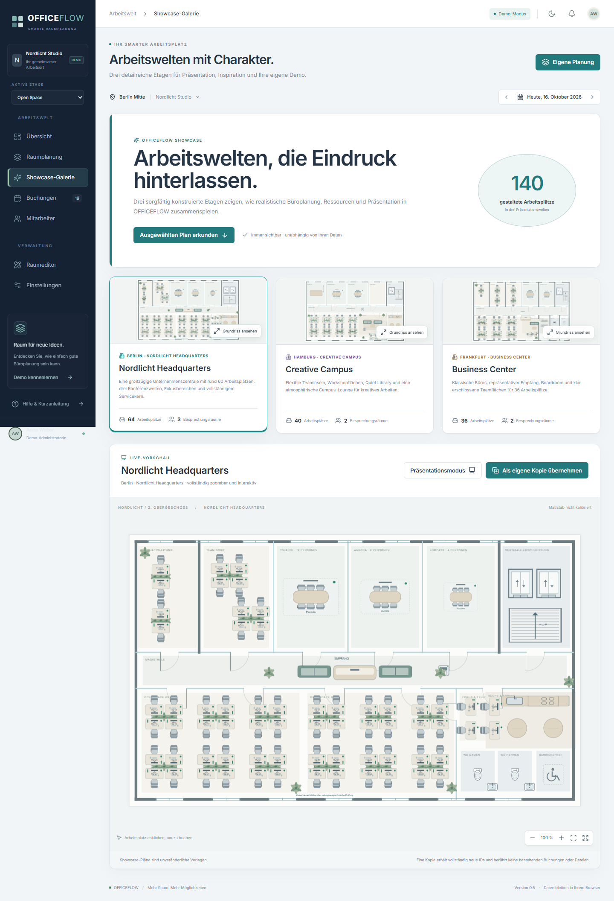
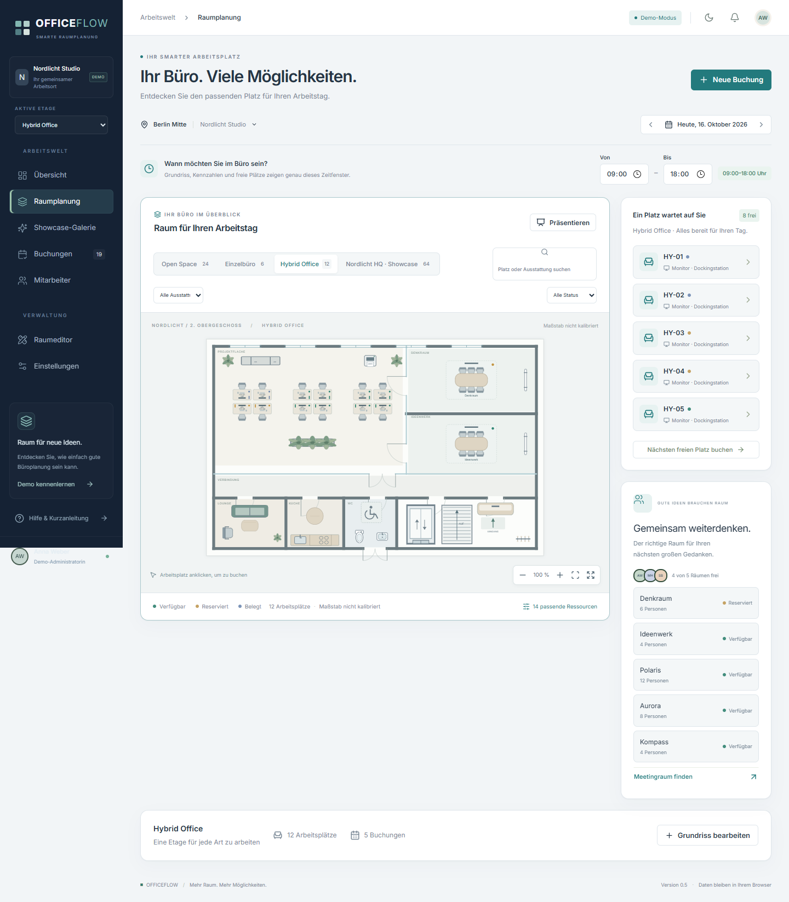

# OFFICEFLOW 0.5

**Ihr Büro. Besser organisiert.** Eine vollständig deutschsprachige Büro-, Arbeitsplatz- und Raumplanung mit lokaler Demo und optionaler, lesender Microsoft-365-/SharePoint-Anbindung.

**[Öffentliche Demo](https://craine92.github.io/OFFICEFLOW/)** · [Raumeditor öffnen](https://craine92.github.io/OFFICEFLOW/#/editor)

Neu in 0.5: eine visuell und inhaltlich neu strukturierte Premium-Oberfläche, sechs echte Dashboard-Kennzahlen, eine große interaktive Etagenansicht, Ressourcenrecherche vor der Buchung, ein dauerhaft sichtbarer Editor-Katalog, ein geführter Kurzeinstieg und eine eigenständige Showcase-Galerie mit drei detailreichen Büroetagen. Alle 0.4-Funktionen einschließlich der optionalen, lesenden Microsoft-365-Anbindung bleiben erhalten.


## Lokal starten

Voraussetzung: Node.js ab 22.12 mit npm. Ein Backend, Microsoft-Konto oder Zugangsdaten sind nicht erforderlich.

```powershell
npm ci
npm run dev
```

Die ausgegebene Adresse öffnen, standardmäßig **http://127.0.0.1:5173**.

```powershell
npm test                  # Buchungsregeln, Speicherung, Transaktionen und Geometrie
npm run test:e2e          # Browserprüfungen einschließlich visueller Vergleiche
npm run test:visual       # Die fünf visuellen Regressionstests
npm run build             # TypeScript-Prüfung und statischer Produktions-Build
npm run preview           # Produktions-Build lokal ansehen
npm run verify:production # Statischen Build unter /officeflow/ prüfen; erzeugt Bildschirmfotos
```

Unter Windows nutzen die Browserprüfungen den installierten Microsoft Edge im Hintergrund. Auf Linux und macOS zunächst `npx playwright install chromium` ausführen. In GitHub Actions wird Chromium automatisch installiert. `verify:production` benötigt vorher einen aktuellen Build. Das Skript startet seinen Prüfserver selbst und beendet ihn anschließend.

## In der Demo ausprobieren

1. In der **Übersicht** Datum und das gewünschte **Zeitfenster** auswählen. Kennzahlen, Belegungsdiagramm und Grundriss beziehen sich auf genau diesen Zeitraum und alle Bürobereiche.
2. Im Grundriss zwischen **Open Space**, **Einzelbüro**, **Hybrid Office** und der hochwertigen **Nordlicht-HQ-Demo** wechseln. Eine Ressource anklicken, Ausstattung und Tagesbelegung prüfen und erst dann den Buchungsdialog öffnen.
3. Datum, Zeitraum und Mitarbeiter auswählen. Konflikte für denselben Platz oder Mitarbeiter werden verhindert; direkt angrenzende Termine sind möglich.
4. Unter **Buchungen** suchen, nach Büro filtern, Termine exportieren, Anwesenheit bestätigen oder Buchungen nach Bestätigung stornieren.
5. Im **Raumeditor** einen eigenen Grundriss importieren oder einen vorhandenen bearbeiten. Objekte hinzufügen, verschieben, drehen, skalieren und benennen; Ausstattung und Meetingkapazität konfigurieren. **Grundriss speichern** übernimmt den Entwurf in die normale Ansicht. Gebuchte Objekte lassen sich erst nach Stornierung ihrer Buchungen löschen.
6. In der **Showcase-Galerie** drei unveränderliche Etagen erkunden. **Als eigene Kopie übernehmen** erzeugt neue Raum-, Objekt-, Wand-, Zonen- und Gruppen-IDs; bestehende Buchungen und Dateien bleiben unberührt.
7. Unter **Einstellungen** eine vollständige, integritätsgeprüfte Sicherung inklusive importierter Dateien exportieren beziehungsweise nach Vorschau wieder einspielen oder mit **Demo zurücksetzen** den Ausgangsstand neu anlegen.

## Microsoft 365 verbinden

Die GitHub-Pages-Demo startet immer ohne Anmeldung im lokalen Demo-Modus. Erst eine vollständige öffentliche App-Konfiguration und eine bewusste Aktion im Einrichtungsassistenten aktivieren Microsoft 365. Im Microsoft-Modus stammen Etagen, Ressourcen, Personen und Buchungsmetadaten ausschließlich aus den verbundenen SharePoint-Listen; lokale Demo-Buchungen werden nie eingeblendet.

1. Eine Microsoft-Entra-SPA-App registrieren und die verwendete OFFICEFLOW-URL als Redirect-URI hinterlegen.
2. Delegierte Berechtigungen `User.Read` und `Sites.Read.All` konfigurieren und gemäß Tenant-Richtlinie zustimmen lassen.
3. Die Werte `VITE_MS_TENANT_ID`, `VITE_MS_CLIENT_ID` und optional `VITE_MS_REDIRECT_URI` beim Build setzen. Client-Secrets gehören nicht in eine SPA und werden von OFFICEFLOW nicht gelesen.
4. Unter **Einstellungen → Integrationen** anmelden, Site-ID und Listen-IDs eintragen, Datenquellen prüfen und die schreibgeschützte Unternehmensvorschau öffnen.

Das vollständige SharePoint-Schema, Feldzuordnungen, Fehlerverhalten und die Test-Tenant-Einrichtung stehen im [Microsoft-365-Administrationsleitfaden](docs/MICROSOFT-365-INTEGRATION.md). Ohne autorisierten Test-Tenant bestätigen die automatisierten Tests ausschließlich Adapterverhalten mit API-Mocks, keine erfolgreiche Live-Verbindung.

Grün bedeutet im ausgewählten Zeitfenster verfügbar, Gelb reserviert und Blau durch bestätigte Anwesenheit belegt. Eine Buchung von 09:00 bis 13:00 blockiert den Platz **nicht** für 13:00 bis 18:00. Teilweise Überschneidungen zählen als gebucht; direkt angrenzende Termine sind erlaubt. Der Buchungsdialog übernimmt das gewählte Zeitfenster und zeigt Mitarbeiter und alle Buchungszeiten des Platzes am gewählten Tag. Anwesenheit wird für heutige Termine manuell bestätigt, ohne Live-Erkennung.

Ein frischer Demo-Datenbestand enthält **106 Arbeitsplätze**, **5 Meetingräume**, **22 fiktive Mitarbeiter**, 5 Abteilungen und 19 initiale Buchungen. Die drei getrennten Showcase-Vorlagen umfassen zusätzlich **140 Arbeitsplätze** und 7 Meetingräume, zählen aber erst nach einer bewussten Kopie zum eigenen Datenbestand. Daten werden beim ersten Start für das aktuelle Datum in der Zeitzone **Europe/Berlin** erzeugt. Bereits gespeicherte Termine behalten ihr Datum; für einen neuen Demo-Tag die Datumsauswahl verwenden oder die Demo zurücksetzen.

## Showcase-Galerie



- **Nordlicht Headquarters:** rund 60 Arbeitsplätze, Geschäftsleitung, Team- und Open-Space-Flächen, drei Konferenzräume, Fokusbereich, Küche, Sanitär, zwei Aufzüge und Treppe.
- **Creative Campus:** 40 flexible Arbeitsplätze, Workshop- und Projekträume, Quiet Library, Lounge, Community Kitchen und Erschließungskern.
- **Business Center:** 36 Arbeitsplätze, klassische Büros, Empfang, Boardroom, Archiv, Technik und Sanitär.

Die Galerie wird aus statischen, versionierten Vorlagen aufgebaut und bleibt deshalb auch mit alten lokalen Daten oder im lesenden Microsoft-Modus sichtbar. Kopieren ist nur im lokalen Demo-Modus möglich. Die Vorlagen enthalten keine importierten Binärdateien und verändern keine vorhandenen Ressourcenreferenzen.

## Einen eigenen Grundriss einrichten


1. **Raumeditor → Grundriss importieren** öffnen. Ungespeicherte Editoränderungen vorher speichern oder verwerfen.
2. **PNG, JPG/JPEG, WebP oder PDF** auswählen oder in den Dialog ziehen. Grenze: **25 MiB**, Bilder mindestens 32 × 32 Pixel und höchstens 40 Megapixel. Dateiendung, MIME-Typ, Dateisignatur und Dekodierung werden geprüft.
3. Bei einer mehrseitigen PDF die gewünschte Seite auswählen. Bis zu 500 Seiten werden unterstützt; pro Import wird **eine ausgewählte Seite** als Hintergrund übernommen. Weitere Seiten lassen sich separat als eigene Bürobereiche importieren. Passwortgeschützte oder beschädigte PDFs werden mit einer verständlichen Meldung abgelehnt.
4. Den Grundriss in 90°-Schritten drehen, proportional einpassen, links/mittig/rechts ausrichten, die Bildgröße ändern oder die Vorschau per Maus beziehungsweise Touch verschieben.
5. **Neuen Bürobereich anlegen** oder **Hintergrund des bestehenden Bereichs ersetzen** wählen. Beim Ersetzen bleiben alle Objekte, Kennungen, Planabmessungen und Buchungen unverändert.
6. Den Import prüfen und mit **Importieren und speichern** abschließen. Danach Arbeitsplätze und Meetingräume über den Hintergrund legen. Alle Funktionen arbeiten im Browser; es gibt keine Datei-Uploads zu externen Servern.

Zum Ausprobieren liegen ein selbst erstellter [PNG-Grundriss](tests/fixtures/buero-grundriss.png) und eine [zweiseitige PDF](tests/fixtures/zweiseitiger-grundriss.pdf) im Projekt.


Der Editor bietet ein sichtbares 25er-Raster und optionales **intelligentes Einrasten an Wandenden, Objektkanten und Mittelpunkten** mit 5er-Grundraster, Cursorzoom, Verschieben und Großansicht. **Rückgängig/Wiederholen** speichert bis zu 80 Entwurfsschritte pro geöffnetem Bürobereich. Tastatur: `Strg/Cmd+Z`, `Strg/Cmd+Umschalt+Z` oder `Strg/Cmd+Y`; in Textfeldern bleibt das native Text-Undo aktiv.

Objektpositionen sind in **Planeinheiten** gespeichert und unabhängig von Bildschirmgröße oder Zoom. Planbreite und -höhe können zwischen 160 und 6000 Einheiten liegen. Beim bewussten Ändern der Planabmessungen skalieren die Positionen proportional; Möbel behalten ihre Größe in Planeinheiten. Wände, Zonen, Bauteile und Annotationen folgen der Änderung ebenfalls; eine bestehende Maßstabskalibrierung wird dabei entfernt. Die Hintergrundproportionen bleiben erhalten. Objekte können außerdem einzeln skaliert werden.

Objektüberschneidungen werden auch bei gedrehten Rechtecken erkannt und im Plan rot markiert. Die Speicherung einer überlappenden Anordnung benötigt eine ausdrückliche Bestätigung. Automatische Nummern berücksichtigen vorhandene Arbeitsplätze; neue oder geänderte Bezeichnungen müssen eindeutig sein. Die technischen UUIDs bleiben beim Umbenennen und Hintergrundwechsel stabil.

Importdateien werden erst beim bestätigten Import gespeichert. Ein abgeschlossener Import beginnt einen neuen gespeicherten Editorstand. Änderungen danach werden durch **Grundriss speichern** oder **Verwerfen** abgeschlossen; der Status ist jederzeit sichtbar.

## Eine Büroetage entwerfen


1. Im **Raumeditor** einen bestehenden Plan wählen, einen Hintergrund importieren oder über **Leerer Plan** eine Etage anlegen. Die linke Werkzeugleiste, die zentrale Arbeitsfläche und der rechte Inspector bilden den Arbeitsbereich.
2. Mit **Wand zeichnen** Start- und Endpunkt anklicken. Wände verlaufen zunächst rechtwinklig; ihre Enden rasten aneinander ein. Im Inspector Stärke, Material (Massiv-/Glaswand), Koordinaten oder Winkel ändern. Gemeinsame Wandendpunkte lassen sich mit Griffen bearbeiten.
3. **Tür**, **Doppeltür**, **Schiebetür** oder **Fenster** wählen und auf eine Wand klicken. Öffnungen sind der Wand zugeordnet und werden tatsächlich aus ihr ausgespart. Anschlag, Öffnungsrichtung und Position stehen im Inspector.
4. **Raumzone zeichnen** erstellt mit zwei gegenüberliegenden Ecken eine Fläche. Büro, Flur, Lounge, Küche, WC, Technik oder Lager sind bauliche Zonen. Einen **buchbaren Meetingraum** separat aus dem Katalog hinzufügen und bei Bedarf einer Zone zuordnen.
5. Im **Möbelkatalog** suchen oder Kategorien filtern: Aufzug, Treppe, Eingang, Stützen, Büroausstattung, Konferenz-/Gemeinschaftsmöbel, Küche, Sanitär und Pflanzen. Sterne merken Favoriten lokal. Zweier-, Vierer- und Sechsergruppen enthalten jeweils einzeln buchbare Arbeitsplätze mit eigener Nummer und UUID.
6. Elemente per Maus, Auswahlrahmen, Umschalttaste oder Auswahlliste auswählen. Größen und freie Winkel ändern, mit Griffen skalieren, in 15°-Schritten drehen, gruppieren, duplizieren, ausrichten oder gleichmäßig verteilen. Das Kontextmenü bietet Kopieren, Duplizieren, Vordergrund und Löschen.
7. Unter **Ebenen** Hintergrund, Architektur, Gebäudeeinrichtung, Ressourcen und Annotationen unabhängig einblenden oder sperren. Gesperrte Elemente sind nicht auswählbar. Die Benutzeransicht besitzt keine Bearbeitungsgriffe.
8. Mit **Maßstab kalibrieren** zwei Endpunkte einer bekannten Strecke anklicken und deren Länge eingeben. Erst danach erscheinen reale Meter. Das Maßband erstellt bleibende Maßlinien. Ohne Kalibrierung bleiben alle Angaben in Planeinheiten.
9. **Plan** zeigt Hintergrundeinstellungen und Geometriehinweise. Fehler außerhalb der Planfläche verhindern das Speichern; Überschneidungen können nach Bestätigung bewusst übernommen werden. Eine Raumzone darf Möbel enthalten. **Grundriss speichern**, **Verwerfen** und der sichtbare Änderungsstatus schließen die Bearbeitung ab.
10. Über **Präsentieren** in der Raumplanung die Ansicht ohne Navigation und Editorwerkzeuge öffnen. Etage, Datum und Zeitfenster bleiben wählbar; ein Klick auf eine Ressource zeigt Ausstattung, Mitarbeiter und Buchungszeiten. Direkter Einstieg: [Präsentationsmodus](https://craine92.github.io/OFFICEFLOW/#/praesentation).

Tastatur: **Leertaste** schwenkt den Plan, **Pfeile** bewegen die Auswahl (mit Umschalt schneller), **Strg/Cmd+C/V** kopiert/fügt ein, **Strg/Cmd+D** dupliziert, **Entf** löscht, **Strg/Cmd+S** speichert. **Escape** beendet einen Zeichenbeginn. Kopieren/Einfügen gilt innerhalb der aktiven Anwendung, auch zwischen Bürobereichen.

Die neuen Präsentationspläne erscheinen bei frischen Browserdaten. Vorhandene Entwürfe und Buchungen werden durch das Update erhalten. Wer die neuen Pläne bewusst laden möchte, kann unter Einstellungen die Demo zurücksetzen; dieser Vorgang löscht eigene Daten und importierte Dateien.



## Auf GitHub Pages veröffentlichen

Ein automatischer Workflow liegt in [`.github/workflows/deploy.yml`](.github/workflows/deploy.yml). Er führt fachliche Tests, Browserprüfungen, Produktions-Build und die zusätzliche statische Import-/PDF-Prüfung aus und veröffentlicht ausschließlich `dist/`.

1. Ein **öffentliches GitHub-Repository** anlegen oder ein vorhandenes auswählen.
2. Die Projektdateien einschließlich `package-lock.json` und `.github/` auf den Branch `main` übertragen. `node_modules/`, `dist/` und lokale Testausgaben bleiben ausgeschlossen.
3. Im Repository **Settings → Pages → Build and deployment → Source: GitHub Actions** auswählen.
4. Auf `main` pushen oder den Workflow **OFFICEFLOW auf GitHub Pages** unter **Actions** manuell starten.
5. Die tatsächliche URL erscheint nach erfolgreichem Deployment im Workflow und unter **Settings → Pages**. Bei einem normalen Repository lautet sie `https://BESITZER.github.io/REPOSITORY/`.

Beispiel für ein neues lokales Repository; Großbuchstaben durch die eigenen Werte ersetzen:

```powershell
git init -b main
git add .
git commit -m "OFFICEFLOW: erste funktionsfähige Demo"
git remote add origin https://github.com/BESITZER/REPOSITORY.git
git push -u origin main
```

Der Workflow setzt `VITE_BASE_PATH` automatisch passend zum Repository. Ein Benutzer-Repository namens `BESITZER.github.io` bekommt `/`; ein Projekt-Repository bekommt `/REPOSITORY/`. Lokal ist die Vite-Basis `./`, sodass der Build auch unter wechselnden Verzeichnissen funktioniert.

Die Navigation nutzt **Hash-Routing**. Direkte Adressen wie `https://BESITZER.github.io/REPOSITORY/#/buchungen` funktionieren beim Neuladen ohne Server-Rewrites oder eine 404-Umleitung. Pfade ohne Hash wie `/REPOSITORY/buchungen` sind keine unterstützten Demo-URLs.

Für einen manuellen Build mit festem Repository-Unterpfad in PowerShell:

```powershell
$env:VITE_BASE_PATH = '/REPOSITORY/'
npm run build
Remove-Item Env:VITE_BASE_PATH
```

Der Quellcode liegt in [Craine92/OFFICEFLOW](https://github.com/Craine92/OFFICEFLOW). Die Demo-Adresse lautet **https://craine92.github.io/OFFICEFLOW/**. GitHub Pages ist öffentlich mit HTTPS und GitHub Actions eingerichtet; den aktuellen Veröffentlichungsstatus zeigt [GitHub Actions](https://github.com/Craine92/OFFICEFLOW/actions).

## Architektur

```text
src/
  components/       Oberfläche, Grundriss, Buchungsdialog und Tabelle
    ui/             shadcn/ui-Bausteine auf Radix: Button und Dialog
  pages/            Showcase, Präsentation, Buchungen, Mitarbeiter, Raumeditor und Einstellungen
  domain/           Datenmodelle, Buchungsregeln, Status und Grundrissgeometrie
  data/             Datenanbieter, Showcase-Vorlagen, Migration, IndexedDB, Datei-/PDF-Verarbeitung
  integrations/     MSAL, Graph-Client, SharePoint-Mapping und Betriebsartsteuerung
  hooks/            Entwurfshistorie und lokales Laden von Hintergrundbildern
  store/            Zustand-Store und serialisierte Schreibtransaktionen
  styles/           Zentrale Design-Tokens und Enterprise-Oberfläche
  lib/              Gemeinsame UI-Hilfsfunktionen
tests/e2e/          Durchgängige Browserprüfungen
tests/fixtures/     Eigene Bild- und mehrseitige PDF-Beispieldateien
tests/visual/       Eingecheckte Referenzbilder für automatische Bildvergleiche
scripts/            Lokale PDF-Ressourcen und statische Produktionsprüfung
docs/               Entwicklungsstand, Architekturhinweise und Bildschirmfotos
```

Technik: React 19, TypeScript, Vite, Tailwind CSS 4, shadcn/ui-Muster und Radix Dialog, Lucide, React Konva, Zustand und PDF.js. PDF-Code und Worker werden erst bei einem PDF-Import geladen. Der `postinstall`-Schritt kopiert Schriften, CMaps, Decoder und Lizenz von PDF.js nach `public/pdfjs/`; Vite veröffentlicht sie mit dem Build. Es werden keine externen CDNs benötigt. Nach Änderungen an der PDF.js-Abhängigkeit `npm install` oder `npm run postinstall` ausführen.

### Datenzugriff und Microsoft-Anbindung

`WorkspaceDataProvider` definiert `load`, `save` und `reset`. `DemoDataProvider` implementiert den Metadatenzugriff auf localStorage unter dem absichtlich beibehaltenen Schlüssel `officeflow.demo.v1`; Hintergrunddateien liegen in IndexedDB. `MicrosoftGraphDataProvider` lädt dagegen ausschließlich echte SharePoint-Daten und kennzeichnet sich als schreibgeschützt. Der Store blockiert damit alle lokalen Schreibtransaktionen im Microsoft-Modus.

`MicrosoftAuth` kapselt MSAL Browser. MSAL führt den Authorization Code Flow mit PKCE aus, verwaltet Token in `sessionStorage` und versucht vor jeder Graph-Anfrage eine stille Aktualisierung. Interaktionserfordernisse und abgelaufene Sitzungen werden ausdrücklich gemeldet. `GraphClient` setzt Bearer-Token ausschließlich im HTTP-Header, liest `@odata.nextLink` vollständig und behandelt Netzwerkfehler, Berechtigungen, fehlende Ressourcen sowie Throttling mit begrenzten Wiederholungen.

Produktive Schreibzugriffe bleiben bewusst deaktiviert. Eine clientseitige Verfügbarkeitsprüfung ist keine atomare Konfliktkontrolle. Die Zielarchitektur für Buchung, Stornierung, Identität, ETags, Änderungsprotokoll und Zeitzonen ist im [Integrationsleitfaden](docs/MICROSOFT-365-INTEGRATION.md) dokumentiert.

## Speicherung und Grenzen

- **Migration:** Gültige Version-1- und Version-2-Daten werden beim Laden auf Schema 3 migriert. Die Originaldaten werden vorher unverändert unter `officeflow.demo.backup.v1` beziehungsweise `officeflow.demo.backup.v2` gesichert. Bestehende Pflanzen und Loungeobjekte werden mit identischer Kennung als Ausstattung übernommen. Neue Präsentationslayouts ersetzen keine vorhandenen Entwürfe. Buchungen, Mitarbeiter, Objektkennungen und Positionen bleiben erhalten. Ein Speicherfehler bricht die Migration ab; alte Daten werden nicht still ersetzt. Es ist kein Demo-Reset für das Update erforderlich.
- **IndexedDB:** Datenbank `officeflow-plans`, Version 1, Store `assets`. Jeder Hintergrund hat eine unveränderliche Kennung und enthält die Originaldatei sowie ein PNG der ausgewählten Seite. Vorschauen werden auf maximal 2400 Pixel an der langen Seite begrenzt; die Originaldatei bleibt erhalten. Metadaten verweisen nur auf die Datei-ID und die Transformation.
- **Konsistenz:** Erst wird die Datei in IndexedDB gespeichert, dann der Raum im Datenanbieter. Bei einem Fehler im zweiten Schritt wird das neue Asset wieder entfernt. Eine fehlende Hintergrunddatei wird als Ladefehler angezeigt und löscht keine Objekte oder Buchungen. Demo-Reset leert auch IndexedDB und entfernt die Migrationssicherung.
- Demo-Daten sind pro Browser und Origin gespeichert. Ein Neuladen erhält Buchungen und Grundrissänderungen. Der Hell-/Dunkelmodus wird separat gespeichert.
- Zwei Repository-Demos auf derselben GitHub-Pages-Origin würden dieselben Speicherschlüssel teilen. Für mehrere Installationen sowohl localStorage-Schlüssel als auch IndexedDB-Namen pro Projekt abwandeln. Für das bestehende Repository bleibt der Namensraum aus Kompatibilitätsgründen erhalten.
- Keine geräteübergreifende oder tabübergreifende Synchronisierung. Parallele Browser-Tabs können den lokalen Stand überschreiben. Die lokale Konfliktprüfung gilt für die aktive App-Instanz.
- Der Demo-Modus besitzt keine Authentifizierung oder echten Administratorrollen: Alle Besucher dürfen ausschließlich ihre eigenen lokalen Browserdaten bearbeiten. Im Microsoft-Modus erzwingt Entra ID die Identität und Graph die Tenant-Berechtigungen; ein Frontend-Schalter vergibt keine Rolle.
- Keine wiederkehrenden oder mehrtägigen Buchungen. Zeitfenster liegen zwischen 07:00 und 22:00 Uhr eines Tages.
- Wände, Öffnungen, Zonen, Einrichtung und Ressourcen sind editierbare Vektoren. Keine automatische Erkennung aus Bilddateien und keine bauliche oder Fluchtwegprüfung. Kollisionen verwenden geometrische Rechtecke. Das WC-Symbol stellt keine Zertifizierung der Barrierefreiheit dar. Maße werden erst nach manueller Kalibrierung als Meter angezeigt.
- Der Sicherungsexport enthält Schema-Version, Buchungen, Plan-Metadaten, Originaldateien und gerenderte Hintergründe. SHA-256-Prüfsummen und Schema-Prüfung laufen vollständig vor der Vorschau. Erst eine Bestätigung ersetzt den Bestand; bei einem Schreibfehler wird der vorherige Daten- und Dateistand wiederhergestellt.
- Browserdaten können durch Löschen der Websitedaten, privaten Modus oder Speicherbereinigung des Browsers verloren gehen. Die App meldet Speicherfehler; sie ersetzt kein zentrales Backup.

## Prüfstand

Die Referenzbilder unter `tests/visual/` werden mit festem Datum und lokal gebündelter Schrift geprüft. Nach einer beabsichtigten UI-Änderung `npm run test:visual -- --update-snapshots` ausführen, die Bilder prüfen und gemeinsam mit dem Code einchecken. Datums-/Zeitfelder sind im Bildvergleich maskiert; deren Funktion wird separat getestet. Screenshots aller Hauptansichten finden sich unter `docs/screenshots/`. Eigene Vektorsymbole benötigen keine Fremdassets; die Lizenz der mitgelieferten Inter-Schrift liegt in `public/licenses/Inter-OFL.txt`.

Version 0.5 enthält **62 fachliche Tests** und **37 Playwright-Browserprüfungen**, einschließlich aller bisherigen Abläufe sowie Showcase-Kopie und -Buchung, Konfiguration, Graph-Paginierung, Throttling, Berechtigungs- und Netzwerkfehler, stabile SharePoint-Zuordnung, getrennte Places-/Exchange-Quellen und vollständige Sicherungen. Die Graph-Tests verwenden Mocks und benötigen keinen Tenant. Geprüfte Breiten: 390, 768, 1024, 1440 und 1920 Pixel.

`verify:production` liefert ausschließlich den echten Build unter einem Repository-Unterpfad aus und prüft direkte Navigation, Neuladen, PDF-Worker, lokale PDF-Ressourcen, Seite 2 einer PDF, Bildimport, Buchung auf eigenem Plan und Persistenz. Dabei werden die dokumentierten Bildschirmfotos erzeugt.

Offene Punkte und die nächsten Umsetzungsschritte: [docs/ENTWICKLUNGSSTAND.md](docs/ENTWICKLUNGSSTAND.md).
