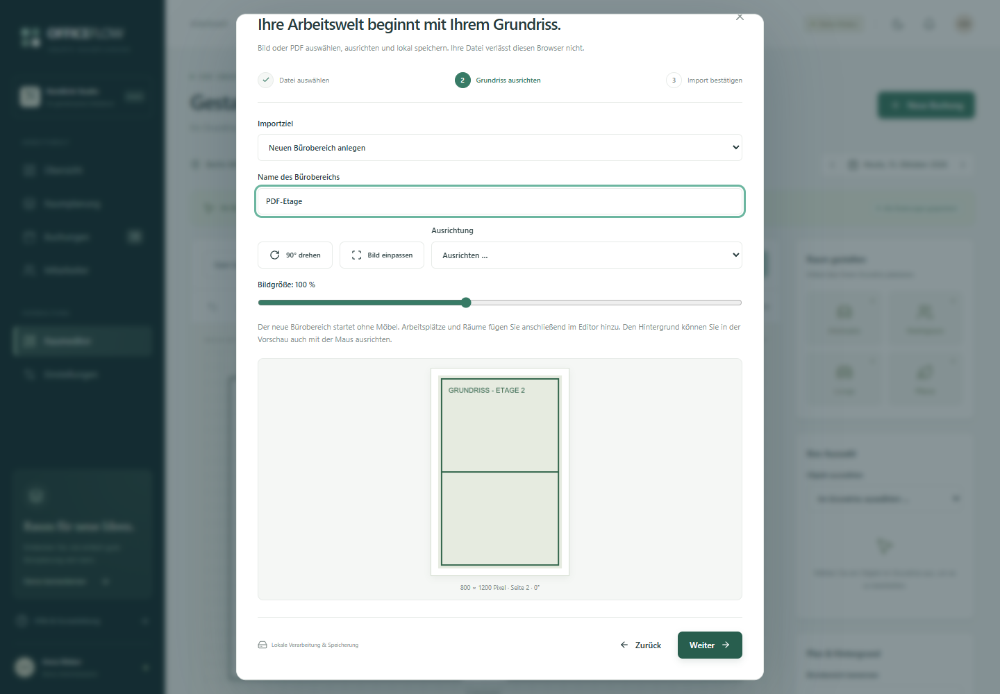
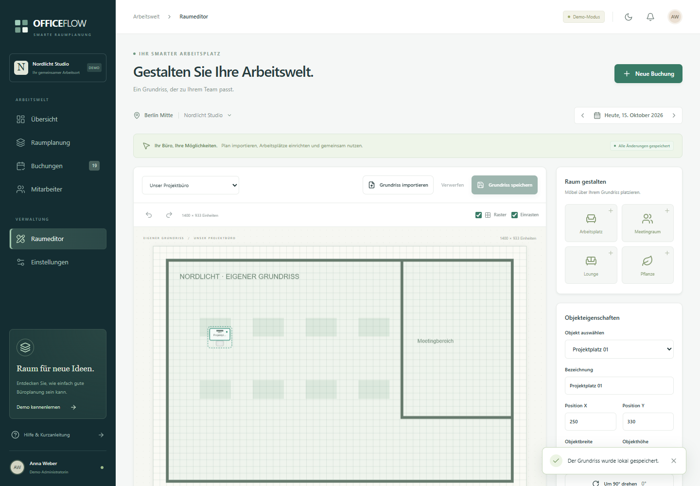

# OFFICEFLOW 0.2

**Ihr Büro. Besser organisiert.** Eine vollständig deutschsprachige, statische Demo für visuelle Büro-, Arbeitsplatz- und Raumplanung.

**[Öffentliche Demo](https://craine92.github.io/OFFICEFLOW/)** · [Raumeditor öffnen](https://craine92.github.io/OFFICEFLOW/#/editor)

Neu in 0.2: eigene Bild- und PDF-Grundrisse, ein Import-Assistent, IndexedDB-Dateispeicherung, Undo/Redo, dynamische Planabmessungen, Objektüberschneidungen und zeitgenaue Verfügbarkeit.


## Lokal starten

Voraussetzung: Node.js 22 mit npm. Ein Backend, Microsoft-Konto oder Zugangsdaten sind nicht erforderlich.

```powershell
npm ci
npm run dev
```

Die ausgegebene Adresse öffnen, standardmäßig **http://127.0.0.1:5173**.

```powershell
npm test                  # Buchungsregeln, Speicherung, Transaktionen und Geometrie
npm run test:e2e          # Automatisierte Browserprüfungen
npm run build             # TypeScript-Prüfung und statischer Produktions-Build
npm run preview           # Produktions-Build lokal ansehen
npm run verify:production # Statischen Build unter /officeflow/ prüfen; erzeugt Bildschirmfotos
```

Unter Windows nutzen die Browserprüfungen den installierten Microsoft Edge im Hintergrund. Auf Linux und macOS zunächst `npx playwright install chromium` ausführen. In GitHub Actions wird Chromium automatisch installiert. `verify:production` benötigt vorher einen aktuellen Build. Das Skript startet seinen Prüfserver selbst und beendet ihn anschließend.

## In der Demo ausprobieren

1. In der **Übersicht** Datum und das gewünschte **Zeitfenster** auswählen. Kennzahlen, Belegungsdiagramm und Grundriss beziehen sich auf genau diesen Zeitraum und alle Bürobereiche.
2. Im Grundriss zwischen **Open Space**, **Einzelbüro** und **Hybrid Office** wechseln. Arbeitsplätze und Meetingräume anklicken; alternativ über **Neue Buchung** und die Auswahllisten buchen.
3. Datum, Zeitraum und Mitarbeiter auswählen. Konflikte für denselben Platz oder Mitarbeiter werden verhindert; direkt angrenzende Termine sind möglich.
4. Unter **Buchungen** suchen, nach Büro filtern, Termine exportieren, Anwesenheit bestätigen oder Buchungen nach Bestätigung stornieren.
5. Im **Raumeditor** einen eigenen Grundriss importieren oder einen vorhandenen bearbeiten. Objekte hinzufügen, verschieben, drehen, skalieren und benennen; Ausstattung und Meetingkapazität konfigurieren. **Grundriss speichern** übernimmt den Entwurf in die normale Ansicht. Gebuchte Objekte lassen sich erst nach Stornierung ihrer Buchungen löschen.
6. Unter **Einstellungen** Metadaten und Buchungen als JSON exportieren oder mit **Demo zurücksetzen** den vollständigen Ausgangsstand neu anlegen, einschließlich Löschen aller importierten Dateien.

Grün bedeutet im ausgewählten Zeitfenster verfügbar, Gelb reserviert und Blau durch bestätigte Anwesenheit belegt. Eine Buchung von 09:00 bis 13:00 blockiert den Platz **nicht** für 13:00 bis 18:00. Teilweise Überschneidungen zählen als gebucht; direkt angrenzende Termine sind erlaubt. Der Buchungsdialog übernimmt das gewählte Zeitfenster und zeigt Mitarbeiter und alle Buchungszeiten des Platzes am gewählten Tag. Anwesenheit wird für heutige Termine manuell bestätigt, ohne Live-Erkennung.

Die Demo enthält **42 Arbeitsplätze**, **2 Meetingräume**, eine Lounge, **22 fiktive Mitarbeiter**, 5 Abteilungen und 19 initiale Buchungen. Daten werden beim ersten Start für das aktuelle Datum in der Zeitzone **Europe/Berlin** erzeugt. Bereits gespeicherte Termine behalten ihr Datum; für einen neuen Demo-Tag die Datumsauswahl verwenden oder die Demo zurücksetzen.

## Einen eigenen Grundriss einrichten



1. **Raumeditor → Grundriss importieren** öffnen. Ungespeicherte Editoränderungen vorher speichern oder verwerfen.
2. **PNG, JPG/JPEG, WebP oder PDF** auswählen oder in den Dialog ziehen. Grenze: **25 MiB**, Bilder mindestens 32 × 32 Pixel und höchstens 40 Megapixel. Dateiendung, MIME-Typ, Dateisignatur und Dekodierung werden geprüft.
3. Bei einer mehrseitigen PDF die gewünschte Seite auswählen. Bis zu 500 Seiten werden unterstützt; pro Import wird **eine ausgewählte Seite** als Hintergrund übernommen. Weitere Seiten lassen sich separat als eigene Bürobereiche importieren. Passwortgeschützte oder beschädigte PDFs werden mit einer verständlichen Meldung abgelehnt.
4. Den Grundriss in 90°-Schritten drehen, proportional einpassen, links/mittig/rechts ausrichten, die Bildgröße ändern oder die Vorschau per Maus beziehungsweise Touch verschieben.
5. **Neuen Bürobereich anlegen** oder **Hintergrund des bestehenden Bereichs ersetzen** wählen. Beim Ersetzen bleiben alle Objekte, Kennungen, Planabmessungen und Buchungen unverändert.
6. Den Import prüfen und mit **Importieren und speichern** abschließen. Danach Arbeitsplätze und Meetingräume über den Hintergrund legen. Alle Funktionen arbeiten im Browser; es gibt keine Datei-Uploads zu externen Servern.

Zum Ausprobieren liegen ein selbst erstellter [PNG-Grundriss](tests/fixtures/buero-grundriss.png) und eine [zweiseitige PDF](tests/fixtures/zweiseitiger-grundriss.pdf) im Projekt.



Der Editor bietet ein sichtbares 25er-Raster und optionales **Einrasten in 5er-Schritten**, Zoom, Verschieben und Großansicht. **Rückgängig/Wiederholen** speichert bis zu 80 Entwurfsschritte pro geöffnetem Bürobereich. Tastatur: `Strg/Cmd+Z`, `Strg/Cmd+Umschalt+Z` oder `Strg/Cmd+Y`; in Textfeldern bleibt das native Text-Undo aktiv.

Objektpositionen sind in **Planeinheiten** gespeichert und unabhängig von Bildschirmgröße oder Zoom. Planbreite und -höhe können zwischen 160 und 6000 Einheiten liegen. Beim bewussten Ändern der Planabmessungen skalieren die Positionen proportional; Möbel behalten ihre Größe in Planeinheiten. Die Hintergrundproportionen bleiben erhalten. Objekte können außerdem einzeln skaliert werden.

Objektüberschneidungen werden auch bei gedrehten Rechtecken erkannt und im Plan rot markiert. Die Speicherung einer überlappenden Anordnung benötigt eine ausdrückliche Bestätigung. Automatische Nummern berücksichtigen vorhandene Arbeitsplätze; neue oder geänderte Bezeichnungen müssen eindeutig sein. Die technischen UUIDs bleiben beim Umbenennen und Hintergrundwechsel stabil.

Importdateien werden erst beim bestätigten Import gespeichert. Ein abgeschlossener Import beginnt einen neuen gespeicherten Editorstand. Änderungen danach werden durch **Grundriss speichern** oder **Verwerfen** abgeschlossen; der Status ist jederzeit sichtbar.

## Auf GitHub Pages veröffentlichen

Ein automatischer Workflow liegt in [`.github/workflows/deploy.yml`](.github/workflows/deploy.yml). Er führt fachliche Tests, Browserprüfungen, Produktions-Build und die zusätzliche statische Import-/PDF-Prüfung aus und veröffentlicht ausschließlich `dist/`.

1. Ein **öffentliches GitHub-Repository** anlegen oder ein vorhandenes auswählen.
2. Die Projektdateien einschließlich `package-lock.json` und `.github/` auf den Branch `main` übertragen. `node_modules/`, `dist/` und lokale Testausgaben bleiben ausgeschlossen.
3. Im Repository **Settings → Pages → Build and deployment → Source: GitHub Actions** auswählen.
4. Auf `main` pushen oder den Workflow **OFFICEFLOW auf GitHub Pages** unter **Actions** manuell starten.
5. Die tatsächliche URL erscheint nach erfolgreichem Deployment im Workflow und unter **Settings → Pages**. Bei einem normalen Repository lautet sie `https://BESITZER.github.io/REPOSITORY/`.

Beispiel für ein neues lokales Repository; Großbuchstaben durch die eigenen Werte ersetzen:

```powershell
git init -b main
git add .
git commit -m "OFFICEFLOW: erste funktionsfähige Demo"
git remote add origin https://github.com/BESITZER/REPOSITORY.git
git push -u origin main
```

Der Workflow setzt `VITE_BASE_PATH` automatisch passend zum Repository. Ein Benutzer-Repository namens `BESITZER.github.io` bekommt `/`; ein Projekt-Repository bekommt `/REPOSITORY/`. Lokal ist die Vite-Basis `./`, sodass der Build auch unter wechselnden Verzeichnissen funktioniert.

Die Navigation nutzt **Hash-Routing**. Direkte Adressen wie `https://BESITZER.github.io/REPOSITORY/#/buchungen` funktionieren beim Neuladen ohne Server-Rewrites oder eine 404-Umleitung. Pfade ohne Hash wie `/REPOSITORY/buchungen` sind keine unterstützten Demo-URLs.

Für einen manuellen Build mit festem Repository-Unterpfad in PowerShell:

```powershell
$env:VITE_BASE_PATH = '/REPOSITORY/'
npm run build
Remove-Item Env:VITE_BASE_PATH
```

Der Quellcode liegt in [Craine92/OFFICEFLOW](https://github.com/Craine92/OFFICEFLOW). Die Demo-Adresse lautet **https://craine92.github.io/OFFICEFLOW/**. GitHub Pages ist öffentlich mit HTTPS und GitHub Actions eingerichtet; den aktuellen Veröffentlichungsstatus zeigt [GitHub Actions](https://github.com/Craine92/OFFICEFLOW/actions).

## Architektur

```text
src/
  components/       Oberfläche, Grundriss, Buchungsdialog und Tabelle
    ui/             shadcn/ui-Bausteine auf Radix: Button und Dialog
  pages/            Buchungen, Mitarbeiter, Raumeditor und Einstellungen
  domain/           Datenmodelle, Buchungsregeln, Status und Grundrissgeometrie
  data/             Datenanbieter, Migration, IndexedDB, Datei-/PDF-Verarbeitung
  hooks/            Entwurfshistorie und lokales Laden von Hintergrundbildern
  store/            Zustand-Store und serialisierte Schreibtransaktionen
  lib/              Gemeinsame UI-Hilfsfunktionen
tests/e2e/          Durchgängige Browserprüfungen
tests/fixtures/     Eigene Bild- und mehrseitige PDF-Beispieldateien
scripts/            Lokale PDF-Ressourcen und statische Produktionsprüfung
docs/               Entwicklungsstand, Architekturhinweise und Bildschirmfotos
```

Technik: React 19, TypeScript, Vite, Tailwind CSS 4, shadcn/ui-Muster und Radix Dialog, Lucide, React Konva, Zustand und PDF.js. PDF-Code und Worker werden erst bei einem PDF-Import geladen. Der `postinstall`-Schritt kopiert Schriften, CMaps, Decoder und Lizenz von PDF.js nach `public/pdfjs/`; Vite veröffentlicht sie mit dem Build. Es werden keine externen CDNs benötigt. Nach Änderungen an der PDF.js-Abhängigkeit `npm install` oder `npm run postinstall` ausführen.

### Datenzugriff und spätere Microsoft-Anbindung

`WorkspaceDataProvider` definiert `load`, `save` und `reset`. `DemoDataProvider` implementiert den Metadatenzugriff auf localStorage unter dem absichtlich beibehaltenen Schlüssel `officeflow.demo.v1`. Das darin gespeicherte Schema hat jetzt **Version 2**. Über `configureDataProvider()` lässt sich vor der Initialisierung ein anderer Anbieter einsetzen. Geschäftsregeln liegen unabhängig von der Darstellung in `domain/`. Hintergrunddateien werden separat über `data/assets.ts` verwaltet.

`MicrosoftGraphGateway` beschreibt den Entwurf für einen späteren Adapter: Räume, Mitarbeiter, Buchungen, Stornierung und Grundrissänderungen; ETags sind für konkurrierende Änderungen vorgesehen. Der Store serialisiert lokale Änderungen und zeigt sie erst nach erfolgreichem Speichern als erfolgreich an. Speicherausfälle werden gemeldet; beschädigte Daten werden nicht still überschrieben.

**Eine Graph-/SharePoint-Integration ist nicht implementiert.** Vor einer produktiven Anbindung fehlen insbesondere Microsoft-Entra-Anmeldung mit PKCE, Berechtigungs- und Rollenkonzept, SharePoint-Datenmodell sowie eine atomare, anbieterübergreifende Konfliktprüfung. Ein reiner Austausch des Demo-Speichers reicht für einen sicheren Mehrbenutzerbetrieb nicht aus. Näheres in [Entwicklungsstand](docs/ENTWICKLUNGSSTAND.md).

## Speicherung und Grenzen

- **Migration:** Gültige Version-1-Daten werden beim Laden automatisch auf Schema 2 migriert. Die Originaldaten werden vorher unverändert unter `officeflow.demo.backup.v1` gesichert. Buchungen, Mitarbeiter, Objektkennungen und Positionen bleiben erhalten. Ein Speicherfehler bricht die Migration ab; alte Daten werden nicht still ersetzt. Es ist kein Demo-Reset für das Update erforderlich.
- **IndexedDB:** Datenbank `officeflow-plans`, Version 1, Store `assets`. Jeder Hintergrund hat eine unveränderliche Kennung und enthält die Originaldatei sowie ein PNG der ausgewählten Seite. Vorschauen werden auf maximal 2400 Pixel an der langen Seite begrenzt; die Originaldatei bleibt erhalten. Metadaten verweisen nur auf die Datei-ID und die Transformation.
- **Konsistenz:** Erst wird die Datei in IndexedDB gespeichert, dann der Raum im Datenanbieter. Bei einem Fehler im zweiten Schritt wird das neue Asset wieder entfernt. Eine fehlende Hintergrunddatei wird als Ladefehler angezeigt und löscht keine Objekte oder Buchungen. Demo-Reset leert auch IndexedDB und entfernt die Migrationssicherung.
- Demo-Daten sind pro Browser und Origin gespeichert. Ein Neuladen erhält Buchungen und Grundrissänderungen. Der Hell-/Dunkelmodus wird separat gespeichert.
- Zwei Repository-Demos auf derselben GitHub-Pages-Origin würden dieselben Speicherschlüssel teilen. Für mehrere Installationen sowohl localStorage-Schlüssel als auch IndexedDB-Namen pro Projekt abwandeln. Für das bestehende Repository bleibt der Namensraum aus Kompatibilitätsgründen erhalten.
- Keine geräteübergreifende oder tabübergreifende Synchronisierung. Parallele Browser-Tabs können den lokalen Stand überschreiben. Die lokale Konfliktprüfung gilt für die aktive App-Instanz.
- Keine Authentifizierung, echte Administratorrechte oder Zugriffskontrolle: Alle Besucher dürfen in ihrem eigenen Demo-Browser bearbeiten.
- Keine wiederkehrenden oder mehrtägigen Buchungen. Zeitfenster liegen zwischen 07:00 und 22:00 Uhr eines Tages.
- Außenwände der drei Demo-Pläne sind Dekoration. Eigene Grundrisse ersetzen sie durch den importierten Hintergrund. Keine automatische Wand- oder Raumerkennung, keine Kalibrierung auf echte Meter und keine bauliche oder Fluchtwegprüfung. Kollisionen beziehen sich auf die geometrischen Objektrechtecke.
- Der JSON-Export enthält Buchungen und Plan-Metadaten, **keine Hintergrunddateien**. Ein vollständiger Datei-/Datenexport mit Wiederimport ist noch nicht enthalten. Originaldateien zusätzlich aufbewahren.
- Browserdaten können durch Löschen der Websitedaten, privaten Modus oder Speicherbereinigung des Browsers verloren gehen. Die App meldet Speicherfehler; sie ersetzt kein zentrales Backup.

## Prüfstand

Version 0.2 enthält **30 fachliche Tests** und **25 Playwright-Browserprüfungen**, einschließlich aller bisherigen Abläufe, Datei- und PDF-Import, Seitenauswahl, Migration, Fehlerfälle, IndexedDB, Undo/Redo, Skalierung, Überschneidungen, Buchungen auf eigenen Plänen und zeitgenaue Verfügbarkeit. Geprüfte Breiten: 390, 768, 1024 und 1440 Pixel.

`verify:production` liefert ausschließlich den echten Build unter einem Repository-Unterpfad aus und prüft direkte Navigation, Neuladen, PDF-Worker, lokale PDF-Ressourcen, Seite 2 einer PDF, Bildimport, Buchung auf eigenem Plan und Persistenz. Dabei werden die dokumentierten Bildschirmfotos erzeugt.

Offene Punkte und die nächsten Umsetzungsschritte: [docs/ENTWICKLUNGSSTAND.md](docs/ENTWICKLUNGSSTAND.md).
