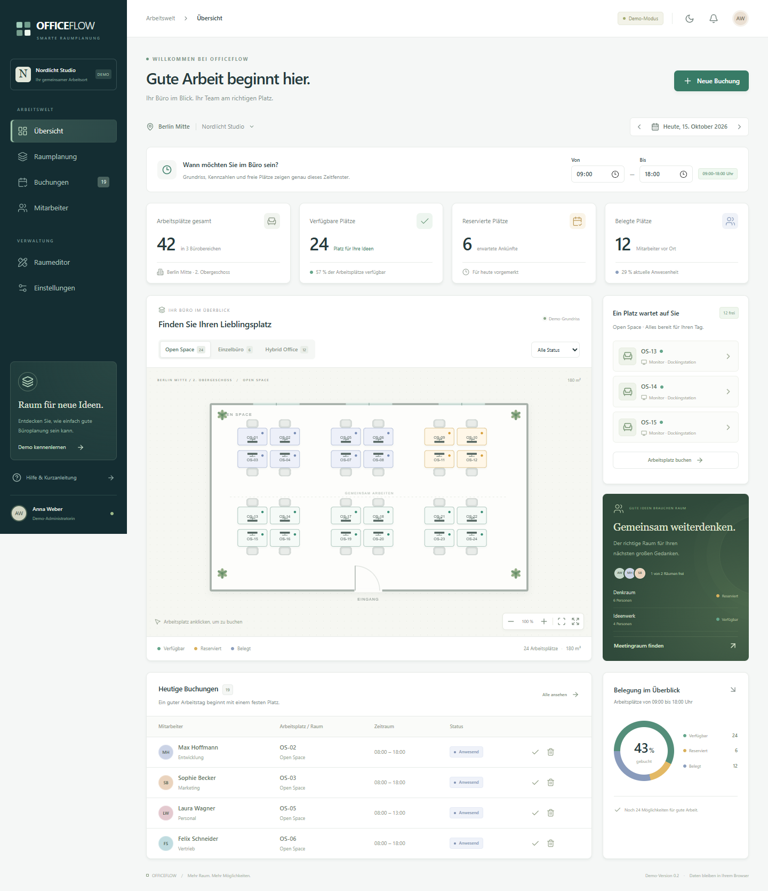

# OFFICEFLOW

**Ihr Büro. Besser organisiert.** Eine vollständig deutschsprachige, statische Demo für visuelle Büro-, Arbeitsplatz- und Raumplanung.



## Lokal starten

Voraussetzung: Node.js 22 mit npm. Ein Backend, Microsoft-Konto oder Zugangsdaten sind nicht erforderlich.

```powershell
npm ci
npm run dev
```

Die ausgegebene Adresse öffnen, standardmäßig **http://127.0.0.1:5173**.

```powershell
npm test                  # Buchungsregeln, Speicherung, Transaktionen und Geometrie
npm run test:e2e          # Automatisierte Browserprüfungen
npm run build             # TypeScript-Prüfung und statischer Produktions-Build
npm run preview           # Produktions-Build lokal ansehen
npm run verify:production # Statischen Build unter /officeflow/ prüfen; erzeugt Bildschirmfotos
```

Unter Windows nutzen die Browserprüfungen den installierten Microsoft Edge im Hintergrund. Auf Linux und macOS zunächst `npx playwright install chromium` ausführen. In GitHub Actions wird Chromium automatisch installiert. `verify:production` benötigt vorher einen aktuellen Build. Das Skript startet seinen Prüfserver selbst und beendet ihn anschließend.

## In der Demo ausprobieren

1. In der **Übersicht** die Kennzahlen und den gewünschten Planungstag ansehen. Die Zahlen beziehen sich auf alle Bürobereiche.
2. Im Grundriss zwischen **Open Space**, **Einzelbüro** und **Hybrid Office** wechseln. Arbeitsplätze und Meetingräume anklicken; alternativ über **Neue Buchung** und die Auswahllisten buchen.
3. Datum, Zeitraum und Mitarbeiter auswählen. Konflikte für denselben Platz oder Mitarbeiter werden verhindert; direkt angrenzende Termine sind möglich.
4. Unter **Buchungen** suchen, nach Büro filtern, Termine exportieren, Anwesenheit bestätigen oder Buchungen nach Bestätigung stornieren.
5. Im **Raumeditor** Objekte hinzufügen, per Maus verschieben, über die Auswahl oder direkt im Plan auswählen, drehen, benennen und Meetingkapazitäten ändern. **Grundriss speichern** übernimmt den Entwurf in die normale Ansicht. Gebuchte Objekte lassen sich erst nach Stornierung ihrer Buchungen löschen.
6. Unter **Einstellungen** Daten als JSON exportieren oder mit **Demo zurücksetzen** den vollständigen Ausgangsstand neu anlegen.

Grün bedeutet am gewählten Tag verfügbar, Gelb reserviert und Blau durch bestätigte Anwesenheit belegt. Die Tagesansicht kennzeichnet einen Arbeitsplatz bereits dann als reserviert, wenn irgendein Zeitraum dieses Tages gebucht ist. Der Buchungsdialog zeigt die konkreten belegten Zeiten; freie Zeitfenster desselben Tages bleiben buchbar. Anwesenheit lässt sich für heutige Buchungen manuell bestätigen und aufheben. Eine laufende Zeitsimulation oder Live-Anwesenheitserkennung besteht nicht.

Die Demo enthält **42 Arbeitsplätze**, **2 Meetingräume**, eine Lounge, **22 fiktive Mitarbeiter**, 5 Abteilungen und 19 initiale Buchungen. Daten werden beim ersten Start für das aktuelle Datum in der Zeitzone **Europe/Berlin** erzeugt. Bereits gespeicherte Termine behalten ihr Datum; für einen neuen Demo-Tag die Datumsauswahl verwenden oder die Demo zurücksetzen.

## Auf GitHub Pages veröffentlichen

Ein automatischer Workflow liegt in [`.github/workflows/deploy.yml`](.github/workflows/deploy.yml). Er führt die fachlichen Tests, Browserprüfungen und den Produktions-Build aus und veröffentlicht ausschließlich `dist/`.

1. Ein **öffentliches GitHub-Repository** anlegen oder ein vorhandenes auswählen.
2. Die Projektdateien einschließlich `package-lock.json` und `.github/` auf den Branch `main` übertragen. `node_modules/`, `dist/` und lokale Testausgaben bleiben ausgeschlossen.
3. Im Repository **Settings → Pages → Build and deployment → Source: GitHub Actions** auswählen.
4. Auf `main` pushen oder den Workflow **OFFICEFLOW auf GitHub Pages** unter **Actions** manuell starten.
5. Die tatsächliche URL erscheint nach erfolgreichem Deployment im Workflow und unter **Settings → Pages**. Bei einem normalen Repository lautet sie `https://BESITZER.github.io/REPOSITORY/`.

Beispiel für ein neues lokales Repository; Großbuchstaben durch die eigenen Werte ersetzen:

```powershell
git init -b main
git add .
git commit -m "OFFICEFLOW: erste funktionsfähige Demo"
git remote add origin https://github.com/BESITZER/REPOSITORY.git
git push -u origin main
```

Der Workflow setzt `VITE_BASE_PATH` automatisch passend zum Repository. Ein Benutzer-Repository namens `BESITZER.github.io` bekommt `/`; ein Projekt-Repository bekommt `/REPOSITORY/`. Lokal ist die Vite-Basis `./`, sodass der Build auch unter wechselnden Verzeichnissen funktioniert.

Die Navigation nutzt **Hash-Routing**. Direkte Adressen wie `https://BESITZER.github.io/REPOSITORY/#/buchungen` funktionieren beim Neuladen ohne Server-Rewrites oder eine 404-Umleitung. Pfade ohne Hash wie `/REPOSITORY/buchungen` sind keine unterstützten Demo-URLs.

Für einen manuellen Build mit festem Repository-Unterpfad in PowerShell:

```powershell
$env:VITE_BASE_PATH = '/REPOSITORY/'
npm run build
Remove-Item Env:VITE_BASE_PATH
```

Der Quellcode liegt in [Craine92/OFFICEFLOW](https://github.com/Craine92/OFFICEFLOW). Die Demo-Adresse lautet **https://craine92.github.io/OFFICEFLOW/**. GitHub Pages ist öffentlich mit HTTPS und GitHub Actions eingerichtet; den aktuellen Veröffentlichungsstatus zeigt [GitHub Actions](https://github.com/Craine92/OFFICEFLOW/actions).

## Architektur

```text
src/
  components/       Oberfläche, Grundriss, Buchungsdialog und Tabelle
    ui/             shadcn/ui-Bausteine auf Radix: Button und Dialog
  pages/            Buchungen, Mitarbeiter, Raumeditor und Einstellungen
  domain/           Datenmodelle, Buchungsregeln, Status und Grundrissgeometrie
  data/             Demo-Datenanbieter, Schnittstellen und Ausgangsdaten
  store/            Zustand-Store und serialisierte Schreibtransaktionen
  lib/              Gemeinsame UI-Hilfsfunktionen
tests/e2e/          Durchgängige Browserprüfungen
scripts/            Prüfung der statischen Produktionsausgabe
docs/               Entwicklungsstand, Architekturhinweise und Bildschirmfotos
```

Technik: React 19, TypeScript, Vite, Tailwind CSS 4, shadcn/ui-Muster und Radix Dialog, Lucide, React Konva und Zustand. Die App benötigt zur Laufzeit keine externen Schriften, Bilder oder CDNs. UI und Canvas sind in getrennte Produktionsdateien aufgeteilt.

### Datenzugriff und spätere Microsoft-Anbindung

`WorkspaceDataProvider` definiert `load`, `save` und `reset`. `DemoDataProvider` implementiert den Zugriff auf localStorage unter `officeflow.demo.v1`. Über `configureDataProvider()` lässt sich vor der Initialisierung ein anderer Anbieter einsetzen. Geschäftsregeln liegen unabhängig von der Darstellung in `domain/`.

`MicrosoftGraphGateway` beschreibt den Entwurf für einen späteren Adapter: Räume, Mitarbeiter, Buchungen, Stornierung und Grundrissänderungen; ETags sind für konkurrierende Änderungen vorgesehen. Der Store serialisiert lokale Änderungen und zeigt sie erst nach erfolgreichem Speichern als erfolgreich an. Speicherausfälle werden gemeldet; beschädigte Daten werden nicht still überschrieben.

**Eine Graph-/SharePoint-Integration ist nicht implementiert.** Vor einer produktiven Anbindung fehlen insbesondere Microsoft-Entra-Anmeldung mit PKCE, Berechtigungs- und Rollenkonzept, SharePoint-Datenmodell sowie eine atomare, anbieterübergreifende Konfliktprüfung. Ein reiner Austausch des Demo-Speichers reicht für einen sicheren Mehrbenutzerbetrieb nicht aus. Näheres in [Entwicklungsstand](docs/ENTWICKLUNGSSTAND.md).

## Speicherung und Grenzen

- Demo-Daten sind pro Browser und Origin gespeichert. Ein Neuladen erhält Buchungen und Grundrissänderungen. Der Hell-/Dunkelmodus wird separat gespeichert.
- Zwei Repository-Demos auf derselben GitHub-Pages-Origin würden denselben localStorage-Schlüssel teilen. Für mehrere Installationen den Schlüssel pro Projekt abwandeln.
- Keine geräteübergreifende oder tabübergreifende Synchronisierung. Parallele Browser-Tabs können den lokalen Stand überschreiben. Die lokale Konfliktprüfung gilt für die aktive App-Instanz.
- Keine Authentifizierung, echte Administratorrechte oder Zugriffskontrolle: Alle Besucher dürfen in ihrem eigenen Demo-Browser bearbeiten.
- Keine wiederkehrenden oder mehrtägigen Buchungen. Zeitfenster liegen zwischen 07:00 und 22:00 Uhr eines Tages.
- Der Editor nutzt feste Außenwände, ein 5er-Raster beim Ziehen und begrenzt Objekte an den Raumkanten. Er ersetzt kein CAD- oder Fluchtwegplanungsprogramm. Überlappungen zwischen manuell verschobenen Objekten werden nicht verhindert.
- Der JSON-Export dient als Datensicherung zur Ansicht; ein Import ist noch nicht implementiert.

## Prüfstand

Die erste Version wurde mit TypeScript, fachlichen Tests und durchgängigen Browserprüfungen in Chromium/Edge überprüft. Geprüft sind Buchungskonflikte, Persistenz, Stornierung, Raumwechsel, Zoom, Editor-Speicherung, Meetingraumkonfiguration, Demo-Reset, Hell-/Dunkelmodus und Breiten von 390, 768, 1024 und 1440 Pixeln. Zusätzlich prüft `verify:production` den echten statischen Build unter einem Repository-Unterpfad einschließlich direktem Aufruf und Neuladen einer Unterseite.

Offene Punkte und die nächsten Umsetzungsschritte: [docs/ENTWICKLUNGSSTAND.md](docs/ENTWICKLUNGSSTAND.md).
